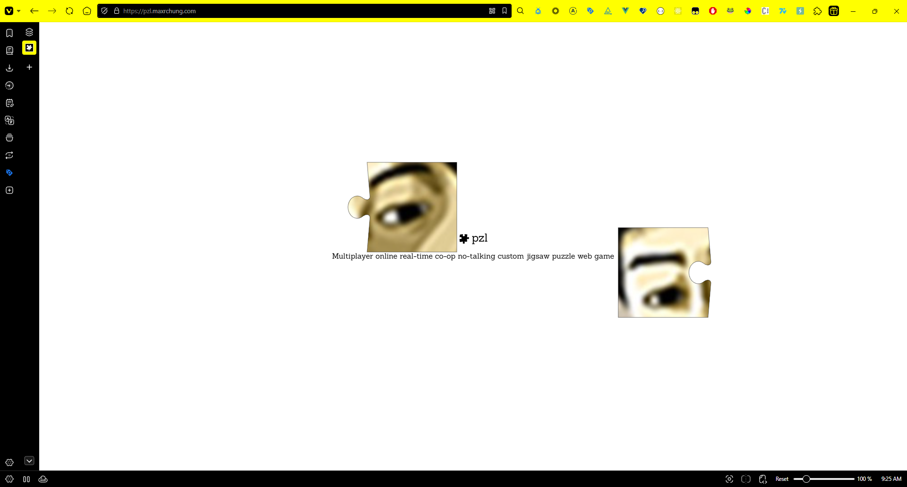
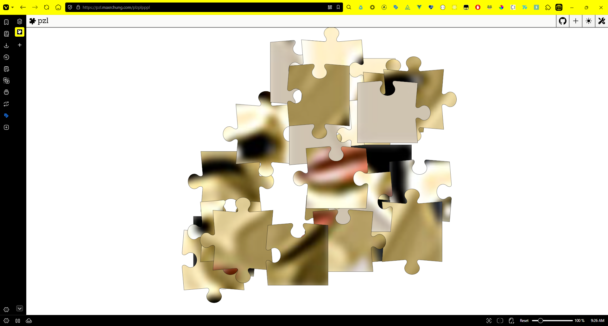
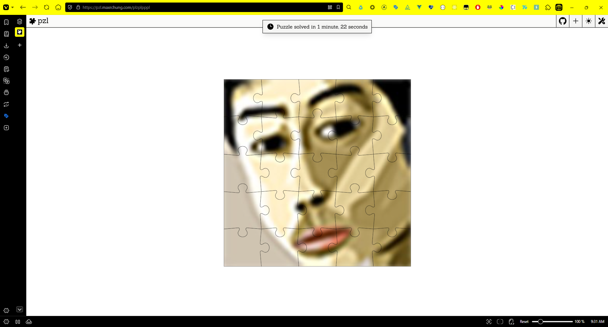
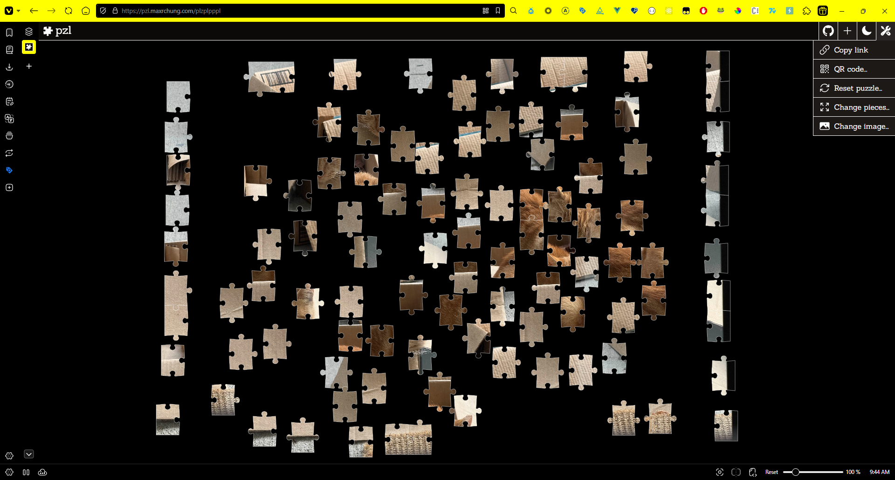

# pzl

Multiplayer online real-time co-op no-talking custom jigsaw puzzle web game

<https://pzl.max.rodeo>

## Features

- Jigsaw puzzle shapes drawn with [Vue Konva](https://konvajs.org/docs/vue/index.html)
- Real-time multiplayer collaboration with [Socket.IO](https://socket.io)
- Mobile support
- Create your own lobbies
- Share with QR code
- Upload custom image
- Change number of pieces
- Zoom in/out
- Dark and light themes

## Screenshots









## Dev notes

### Debug

Use "Debug all" option in debug tab of VS Code. It launches debug server, client, and
Chrome altogether.

### Amplify

Amplify automatically builds the Vue client on push and deploys a static site.

### Railway

Railway automatically builds the socket.io server on push and deploys a Docker
container.

### Docker Hub

This isn't really necessary since Railway builds and deploys the server on push,
but if you ever want to push the server to Docker Hub you can do this:

```sh
docker build . -t chngmx/pzl
docker push chngmx/pzl
```
